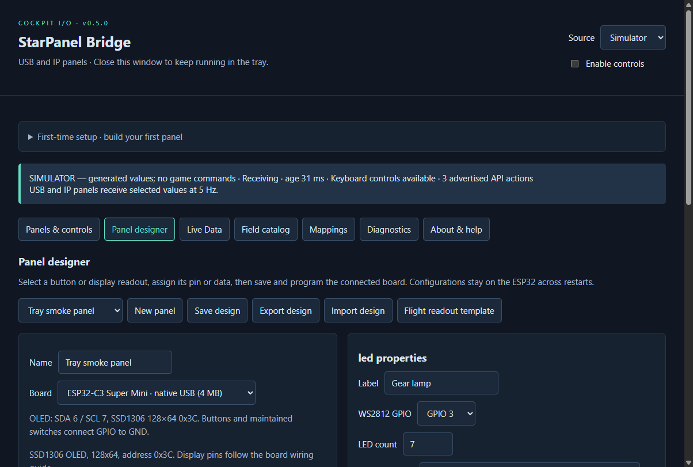

# StarPanel Bridge

Build physical Star Citizen cockpit panels with an installed Windows tray app, configurable ESP32/Arduino firmware, and DCSBIOSKit master/slave support.

[Download installer](https://github.com/RogueTech1/starpanel-bridge/releases/latest) · [Quick start](docs/QUICKSTART.md) · [Master/slave setup](docs/DCSBIOSKIT.md) · [Build from source](docs/REPRODUCING.md) · [Privacy audit](docs/PRIVACY-AUDIT.md)

## Build a panel

- Select a board, add buttons/maintained switches/readouts or an LED rule, and program it from the app.
- Receive live instruments over USB, paired Wi-Fi TCP or a DCSBIOSKit RS485 master.
- Map keyboard bindings and telemetry-backed switches so the game can follow physical positions.
- Configure up to four ordered conditions for a WS2812 chain: color, pulse, strobe, solid light and stale-data shutdown.
- Inspect current fields in **Live Data** and look up inputs, outputs, enums, code examples and RS485 addresses in the integrated **I/O Reference**. Add supported entries directly to your panel design.
- Share credential-free designs and use the included AI skill for custom boards/firmware.

The installer includes firmware and upload tools. End users do not need Node, Python, PlatformIO or an Arduino IDE for built-in profiles. Closing the window keeps the backend running in the tray; hidden UI rendering pauses.

## Supported paths

| Hardware | Connection | Programming |
| --- | --- | --- |
| ESP32 Dev Module / WROOM-32 DevKitC V4 / DOIT V1, 4 MB | USB / Wi-Fi | Bundled firmware, then saved interface |
| ESP32-C3 DevKitM-1 or C3 Super Mini, 4 MB | Correct UART/native USB profile or Wi-Fi | Separate matching images/pin maps |
| ESP32-S3 DevKitC-1, 8 MB; N16/N16R8 variants | USB / Wi-Fi | Conservative S3 image/pins |
| LOLIN ESP32-S2 Mini, 4 MB | Native USB / Wi-Fi | Separate S2 image |
| Uno R3, classic Nano, Mega 2560 | Independent USB | Panel image plus EEPROM design |
| Leonardo, Micro, Pro Micro 5 V/16 MHz | Independent native USB | Matching 32U4 image plus design |
| DCSBIOSKit Master Controller, ATmega2560 | PC USB → three RS485 buses | Dedicated master routing upload/restore flow |
| DCSBIOSKit Nano/Mega slave or shield | Programmer, then vendor bus | Address, pins, commands and readouts in slave EEPROM |

Choose the [exact model/pin/flash profile](docs/HARDWARE.md). Uno R4, Nano Every, Nano ESP32 and ESP32-C6/H2/P4 are not interchangeable with these targets. The project has eight ESP32 images and nine AVR images, including the master. Menu variants can share a compatible image. Compiler support and physical validation levels are documented separately in [Validation](docs/VALIDATION.md).

## DCSBIOSKit: both directions

**Game → host → master → slaves:** StarPanel encodes a private DCS-BIOS output map. The vendor-compatible master broadcasts bytes on all three buses; slave listeners render selected data.

**Switch/button → slave → polled master → host → game:** each slave has an address and unique command aliases. The master polls slaves and returns their messages over USB. StarPanel applies the saved input mapping and control guards.

The factory master already routes compatible traffic. If programming/restoring it, use **Panels & controls → DCSBIOSKit Main / Master Controller → Program DCSBIOSKit Master Controller**. The normal panel uploader stays blocked for designated master ports. Configure each slave separately through its programmer. See the [complete master/slave guide](docs/DCSBIOSKIT.md).

Powered DCSBIOSKit RS485 is **not Ethernet**. Follow the [vendor instructions](https://dcsbioskit.com/instructions/): do not connect it to network equipment, change powered bus cables, or connect slave programmer/USB and powered bus simultaneously.

## First use

1. Install the [latest release](https://github.com/RogueTech1/starpanel-bridge/releases/latest). The Windows build is unsigned; verify its published SHA-256.
2. Click **Enable telemetry startup setting**. Safely close the game and fully exit RSI Launcher once, then reopen both to inherit the setting. Enter a pilot seat for ship data.
3. Design the panel and select the exact COM port. Confirm replacement and upload the matching firmware. ESP32 mapping changes use **Send interface to board**; AVR uploads include their design.
4. For Wi-Fi, provision through USB or the first-start setup AP: `StarPanel-...`, password `StarPanel123`, **http://192.168.4.1/**. Supply your own private LAN credentials, PC address and pairing key locally.
5. Verify outputs before enabling controls. Keyboard mappings require the game's actual bindings and foreground focus. Maintained switches require fresh feedback and recent physical positions.

## Documentation and reproducible source

- [Quick start / Wi-Fi](docs/QUICKSTART.md)
- [Integrated I/O Reference](docs/IO-REFERENCE.md)
- [Board library and full DCSBIOSKit catalog](docs/BOARD-LIBRARY.md)
- [Game telemetry activation and verification](docs/TELEMETRY-SETUP.md)
- [SC Telemetry Deck I/O research and comparison](docs/SC-TELEMETRY-DECK.md)
- [Hardware, parts and wiring](docs/HARDWARE.md)
- [DCSBIOSKit master/slave programming and BORT context](docs/DCSBIOSKIT.md)
- [Panel recipes and shared designs](docs/BUILD-RECIPES.md)
- [Designer, maintained switches and visual rules](docs/DESIGNER.md)
- [Custom firmware and protocol](docs/PROGRAMMING.md)
- [Fresh-checkout build](docs/REPRODUCING.md) and [development/release steps](docs/DEVELOPMENT.md)
- [Synthetic fixtures, replay and private recording sanitization](docs/DATA-REUSE.md)
- [AI skill](docs/AI-ASSISTANT.md), [troubleshooting](docs/TROUBLESHOOTING.md), [validation](docs/VALIDATION.md)
- [Privacy audit](docs/PRIVACY-AUDIT.md), [security](SECURITY.md), [notices](THIRD-PARTY-NOTICES.md)

```powershell
git clone https://github.com/RogueTech1/starpanel-bridge.git
cd starpanel-bridge
npm ci
npm run verify
npm run prepare:desktop
npm run dist
```

The maintained samples are synthetic. Private logs, recordings, credentials, personal build paths and local development probes are not needed to recreate/deploy this project. Preserve required legal notices when redistributing libraries.

## Credits

**ChatGPT Codex (OpenAI)** — AI development contributor, assisting with application and firmware implementation, debugging, testing, documentation and release preparation.

**Inspired by [DCSBIOSKit](https://dcsbioskit.com/) and [DCS-BIOS](https://github.com/DCS-Skunkworks/dcs-bios).** Thanks to their creators/contributors for the modular hardware ecosystem and open cockpit architecture. The Arduino transport uses the pinned [DCSBIOSKit library fork](https://github.com/DCSBIOSKit/dcs-bios-arduino-library).

[BORT](https://github.com/charliefoxtwo/Bort) provides context for data/address discovery; it is not bundled or required. Thanks also to [Sokren's telemetry research](https://github.com/Sokren/sc-telemetry-deck), Espressif, Arduino, Adafruit and U8g2.

Independent community software, not affiliated with Cloud Imperium Games, DCSBIOSKit, Eagle Dynamics or the DCS-BIOS/BORT maintainers. Project code is [MIT licensed](LICENSE); third-party/game ownership and notices remain applicable.


