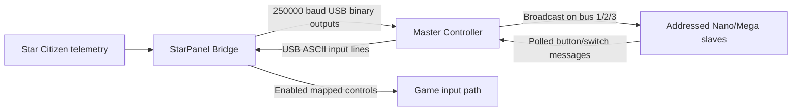

# DCSBIOSKit master and slave programming

The supported main board is the [DCSBIOSKit Master Controller](https://dcsbioskit.com/product/master-controller/), programmed as an ATmega2560/Mega 2560 with the vendor's three RS485 driver-enable pins. It is a bidirectional transport router:



## What must be programmed

| Device | Program/configuration | Why |
| --- | --- | --- |
| Master | Vendor-compatible three-bus routing sketch | Receives PC output bytes, broadcasts them to slaves and polls slaves for input messages |
| Nano/Mega slave or shield | StarPanel configurable slave firmware plus EEPROM design | Selects its bus address, physical input pins, unique command names and output listeners |
| Hub | Vendor wiring/power only | Distributes the compatible powered RS485 bus; no StarPanel firmware upload |
| Standalone USB Arduino | Standalone image plus EEPROM design | Talks directly to the PC without the master |

A working factory master already performs the required routing. It does not need to know ship names, telemetry paths, aircraft JSON or the number of readouts. The game-specific mapping belongs to StarPanel on the PC and the selected listeners/commands in slave designs.

## Program or restore the master

The bundled [`master.cpp`](../firmware-dcsbios/src/master.cpp) follows the [vendor master sketch](https://dcsbioskit.com/master-controller-code/): `DCSBIOS_RS485_MASTER`, UART1 TX-enable **2**, UART2 **3**, UART3 **4**, and `DcsBios::setup()/loop()`. The unused servo header is disabled for a minimal build. The pinned vendor library supplies UART framing and polling.

1. Identify the master USB COM port. Do not select a slave programmer, standalone Mega or ESP32 simply because its port is visible.
2. In **Panels & controls**, select **DCSBIOSKit Main / Master Controller**, select that port and **Connect**. This designates/protects it as a master port.
3. Open **Program DCSBIOSKit Master Controller**. Confirm replacement only for that identified board, then choose **Upload master routing firmware**.
4. The app closes its runtime serial connection, disables live controls, verifies the master-role image, and uploads with ATmega2560 signature/readback checks. It writes **no slave EEPROM design** to the master. The generic panel uploader remains blocked for designated master ports.
5. The runtime master link reconnects at **250000 baud**. Verify outputs/inputs, then enable controls intentionally.

Source build:

```powershell
uv run --with platformio pio run -d firmware-dcsbios -e dcsbioskit-master
```

The master image is `firmware-images/dcsbioskit-master/firmware.hex`; its manifest must declare `role:"master"`. Master upload is separate from the panel board selector. Choosing Mega slave/standalone never selects this image. Actual hardware programming requires the exact board/bootloader and remains a physical validation step.

## Configure each slave for both directions

1. Follow [vendor instructions](https://dcsbioskit.com/instructions/): remove power before changing bus cables, disconnect the slave from the powered bus, connect only its programmer, and use the revision's RS485 switch as directed.
2. In **Panel designer**, choose DCSBIOSKit Mega or Nano. Assign an address from **1–126**. It must be unique on its physical bus; StarPanel currently enforces unique addresses across saved slave designs as a conservative simplification.
3. Add readouts and momentary/maintained inputs. Choose GPIOs and the intended host key/action mapping. Save and **Upload saved Arduino design** to the **slave programmer** COM port.
4. The upload writes slave firmware and a checksummed EEPROM profile. Firmware reads the profile before starting the bus: it sets the slave address, input pins/modes and unique names such as `SC_<panel-id>_<component-id>`.
5. Disconnect the programmer, reconnect the vendor bus with power off, set RS485 ON as instructed, then power it. Only the master USB runtime port needs to be connected to the app.

The slave does not join Wi-Fi or select a master IP. The master discovers/polls its address on the wired bus. A debounced button queues `<unique-command> 1`; a maintained switch queues `0` or `1` and periodically refreshes its physical position. The library returns these messages when polled. The master forwards them to the PC, where `legacyInputs` resolves the name to the saved host mapping. Slaves do not send arbitrary game commands directly.

## Outputs and data discovery

The master broadcasts the same stream on its three buses. Slave listeners choose the relevant address ranges. StarPanel's current private map is:

| Source | Address | Storage / listener |
| --- | --- | --- |
| Fresh/demo status | `0x5000` | uint16; fresh bit 0, demo bit 1 |
| Gear/light indicators | `0x5002` | uint16 bit flags |
| Speed | `0x5010` | 8-byte ASCII slot; `StringBuffer<7>` |
| Altitude | `0x5020` | 10-byte ASCII slot; `StringBuffer<9>` |
| Gear | `0x5030` | 12-byte ASCII slot; `StringBuffer<11>` |
| Oxygen | `0x5040` | 8-byte ASCII slot; `StringBuffer<7>` |
| Heartbeat | `0xfffe` | changing uint16 sequence |

The host reads these bus values from the raw telemetry fields, independently of user-renamed desktop aliases. Missing/stale values become `--` and the fresh bit clears. Slaves also expire the heartbeat after two seconds. The four readout fields show their StarPanel RS485 addresses in **I/O Reference → Outputs**. The code contract is [`src/dcsbios.mjs`](../src/dcsbios.mjs); extending the map requires matching host encoding and slave listeners.

## How BORT relates

[BORT](https://github.com/charliefoxtwo/Bort) is a DCS-BIOS reference/testing UI that reads DCS-BIOS aircraft JSON and helps find addresses/control definitions. It is useful context for the discovery workflow, but its DCS aircraft addresses do not describe Star Citizen. StarPanel's **Live Data**, **I/O Reference** provide the corresponding game-facing discovery views; the private bus map translates selected outputs for these Arduino panels. BORT is referenced, not bundled or used as a runtime dependency.

## Wiring and validation boundary

Powered DCSBIOSKit RS485 is **not Ethernet**. Never connect its ports to network equipment, hot-plug powered bus cables, or connect slave USB/programmer and powered bus simultaneously. Follow the vendor's exact hardware revision and power limits.

The master/slave images compile; tests cover role checks, byte/address maps, EEPROM addressing and distinct slave commands returning to host actions. These tests do not establish electrical timing or physical compatibility with an untested master/slave set. See [Validation](VALIDATION.md), [Hardware](HARDWARE.md) and [Troubleshooting](TROUBLESHOOTING.md).
