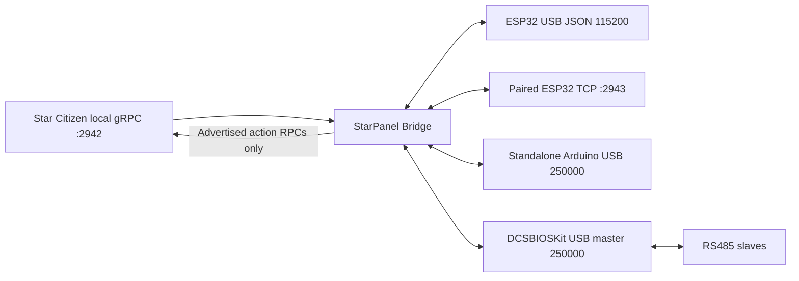

# Advanced programming guide

This guide is for custom boards, displays and integrations outside the visual designer. It describes the implemented protocol; there is no hidden cloud API or in-game framebuffer export.

For synthetic protocol fixtures and scenarios and an offline packet generator, see [Data reuse](DATA-REUSE.md). For a fresh source build, see [Recreate and verify](REPRODUCING.md).

## Architecture and files



`src/game.mjs` loads a protobuf descriptor and reads the local game stream. `src/panel.mjs` extracts mapped fields, rejects stale data and validates commands. `src/bridge.mjs` manages serial devices. `src/network.mjs` authenticates TCP panels. `src/profiles.mjs` validates/compiles designer profiles. `src/dcsbios.mjs` encodes the private Arduino map. `src/avr.mjs` produces EEPROM settings and runs the bundled uploader. The Electron renderer has no Node access; limited IPC lives in `desktop/preload.cjs`.

## JSON framing and transports

Use UTF-8, one JSON object per newline. USB ESP32 transport is **115200 baud, 8N1**. Wi-Fi transport is a plain TCP client connection to the gaming PC on **2943**. TCP is a stream: buffer partial lines and handle several lines per receive. Keep outbound commands under 2048 bytes; starter firmware accepts telemetry/configuration frames up to 4095 bytes. Discard oversized lines until the next newline. The app bounds queues and disconnects slow network readers.

Wi-Fi starts with a subscription containing the app's pairing key:

```json
{"v":1,"type":"subscribe","name":"My custom display","fields":["speed","gear"],"token":"<64-character pairing key>"}
```

USB uses the same subscription without a token. Names are descriptive, not authentication identities. `fields` contains host **aliases**, not protobuf paths. Only aliases already present in the host configuration are accepted. Resubscribe after reconnecting. The server replies with `{"v":1,"type":"subscribed","fields":[...]}` on TCP.

A telemetry packet:

```json
{"v":1,"type":"telemetry","session":"example-session","seq":42,"source":"game","connected":true,"stale":false,"age_ms":12,"error":null,"values":{"speed":123.4,"gear":"VEHICLE_COMPONENT_DEPLOYMENT_STATE_DEPLOYED"}}
```

Packets publish at 5 Hz. Store the latest session/sequence for controls. `source` is `game` or `demo`. Render a clear simulator indicator. Treat `null`, `stale:true`, disconnected, or two seconds without a packet as unavailable. Turn rule outputs off and stop sending control events. Do not treat missing/null as zero, false or an OFF command. Valid literal zero and false must survive parsing.

## A minimal custom Wi-Fi display client

This Python example runs on a computer to demonstrate framing; port the same logic to your board's TCP library. Keep the key outside published source.

```python
import json, os, socket

with socket.create_connection((os.environ['STARPANEL_HOST'], 2943), timeout=5) as s:
    s.sendall((json.dumps({
        'v': 1, 'type': 'subscribe', 'name': 'Example client',
        'fields': ['speed', 'gear'], 'token': os.environ['STARPANEL_TOKEN']
    }) + '\n').encode())
    s.settimeout(3)
    with s.makefile('r', encoding='utf-8') as stream:
        for line in stream:
            if len(line) > 16384:
                raise ValueError('Oversized packet')
            p = json.loads(line)
            if p.get('type') != 'telemetry':
                continue
            if p['stale'] or not p['connected']:
                print('NO FRESH DATA')
                continue
            print(p['values'].get('speed'), p['values'].get('gear'))
```

Production firmware needs explicit reconnect/backoff, a bounded line buffer, stale-data handling and an updated subscription. The starter C++ implementation is in [`firmware/src/main.cpp`](../firmware/src/main.cpp).

## Buttons and maintained switches

Pushbutton event:

```json
{"v":1,"type":"press","id":"boot-random:17","session":"example-session","seq":42,"button":"gear"}
```

Use a unique boot nonce and increasing event ID. Never automatically replay an event after a timeout. Duplicate IDs, foreign sessions, sequences ahead of the host or more than 20 packets behind, stale telemetry, unmapped buttons, disabled controls and unadvertised API actions are rejected. General discrete input rate limit is 200 ms. Responses use `type:"ack"`, echo the ID, and include `ok`, `message` and an optional API response. An accepted command still needs state confirmation.

Maintained switch event:

```json
{"v":1,"type":"switch","id":"boot-random:18","session":"example-session","seq":42,"button":"power_switch","state":false}
```

Report initial positions after fresh telemetry arrives, on every stable edge, and periodically (about three seconds). `false` means physical OFF. The host expires positions after ten seconds without a report. Configure its rule under `switches`; the host, rather than firmware, owns reconciliation:

```json
{
  "fields":{"power":"vehicle.state.power.powerplants"},
  "buttons":{"power_switch":"v_power_set_on"},
  "switches":{
    "power_switch":{
      "path":"vehicle.state.power.powerplants",
      "onValue":true,"offValue":false,
      "onAction":"v_power_set_on","offAction":"v_power_set_off"
    }
  }
}
```

Inputs are API action names only. Use separate advertised ON/OFF names when available; there is no keyboard emulation or arbitrary-code mapping. The designer guide describes stabilization and uncertainty handling.

## Programming ESP32 profiles

The app sends this over USB and waits up to five seconds for a matching acknowledgment:

```json
{"v":1,"type":"configure","id":"unique-id","profile":{"name":"Gear lamp","board":"esp32c3supermini","transport":"usb","buttons":[],"readouts":[],"leds":[{"pin":3,"count":7,"field":"gear","match":"VEHICLE_COMPONENT_DEPLOYMENT_STATE_DEPLOYED","rules":[{"operator":"equals","match":"VEHICLE_COMPONENT_DEPLOYMENT_STATE_DEPLOYED","effect":"pulse","color":"#ff0000","brightness":64,"periodMs":2400}]}]}}
```

The board validates its board ID, GPIOs, maximum component counts and settings before persisting. It replies `{"v":1,"type":"config_ack","id":"unique-id","ok":true,"message":"Interface saved to board"}`. A successful serial write alone is not a successful program operation. Host fields must map `gear` to the protobuf path first; the visual designer compiles matching aliases automatically.

Button entries are `{name,pin,maintained}`. Readout entries are `{field,label}`. A Wi-Fi profile adds `wifi:{ssid,password,host,port:2943,token}` and `transport:"wifi"`. Profiles are stored in ESP32 Preferences/NVS. Wi-Fi credentials and tokens are private configuration, not shareable design data.

One LED chain supports `count` 1–64, and one field with up to four ordered rule cases. Cases use `operator` (`equals`, `notEquals`, `contains`, `greater`, `less`), literal `match`, `effect` (`solid`, `pulse`, `blink`), RGB hex `color`, `brightness` 1–255 and `periodMs` 200–10000. First match wins; none/missing/stale means off. All pixels currently share the result. Add custom firmware if you need independent pixel regions, several data GPIOs, composite conditions or a different display driver.

`{"v":1,"type":"identify"}` returns non-secret `device_info` with board, firmware, setup-network status, LED count/rule and freshness. `{"v":1,"type":"wifi_setup"}` reopens the setup AP on Wi-Fi-capable firmware. The web page uses POST for credentials and does not echo them. Do not publish captured configure packets.

## Standalone Arduino and DCSBIOSKit protocol

The desktop speaks **250000-baud DCS-BIOS binary output / ASCII input** to either a standalone board or the vendor master. Runtime standalone transport uses the same private address map; it does not need DCS World or a DCSBIOSKit master.

| Address | Data |
| --- | --- |
| `0x5000` | uint16 flags: bit 0 fresh, bit 1 simulator |
| `0x5002` | uint16 lamps: bit 0 deployed, bit 1 lights on, bit 2 gear known, bit 3 lights known |
| `0x5010` | 8-byte NUL-terminated speed text slot |
| `0x5020` | 10-byte altitude text slot |
| `0x5030` | 12-byte gear text slot |
| `0x5040` | 8-byte oxygen text slot |
| `0xfffe` | uint16 sequence heartbeat |

Each update starts with four `0x55` sync bytes, then little-endian address/length/data blocks. DCS-BIOS `StringBuffer<N>` uses slot length minus one. Observe both the fresh flag and changing heartbeat; blank stale displays after two seconds.

Inputs are lines such as `SC_GEAR 1\n`; designer aliases use `SC_<panel-id>_<component-id>` in uppercase. Maintained inputs send `0` and `1`; momentary releases are ignored. Map names through `legacyInputs` to host aliases. This legacy wire format has no command IDs/session authentication, so its protections are weaker than paired JSON. Use physically trusted serial/bus devices.

The configurable Arduino firmware is [`firmware-dcsbios/src/configured.cpp`](../firmware-dcsbios/src/configured.cpp). Its packed EEPROM profile is generated by [`src/avr.mjs`](../src/avr.mjs): `SPB1`, address/counts, eight pin/mode/name records, six field/label records, and a 16-bit additive checksum. Total **333 bytes**. The app converts this to Intel HEX, then uploads firmware plus EEPROM with avrdude signature and readback verification. Keep this structure and generator in sync when extending it.

For custom sketches, start with [`firmware-dcsbios/src/configured.cpp`](../firmware-dcsbios/src/configured.cpp) and the [DCSBIOSKit library](https://github.com/DCSBIOSKit/dcs-bios-arduino-library). Assign every bus slave a unique address. The pinned vendor source has a duplicate `resetAllStates` definition; [`patch_vendor.py`](../firmware-dcsbios/patch_vendor.py) removes only that identical duplicate in the build cache. The app's EEPROM workflow already bundles firmware compiled with this fix. Review vendor deferred RS485 processing guidance when adding slow displays.

## New boards and displays

Add a board definition in `src/profiles.mjs`, a matching PlatformIO environment, exact GPIO validation in firmware, a manifest-producing packaging target, and the uploader's allowed target. Do not reuse an image solely because a board says “ESP32.” Test chip/flash rejection before writing. For a new renderer, subscribe only to required aliases, preserve null/false/zero, implement freshness and reconnect handling, and keep input events bounded and idempotent where the transport supports it.

For telemetry definitions consult the app's **I/O Reference**, [`schema/live/field-catalog.json`](../schema/live/field-catalog.json), and the decoded Diagnostics view. Schema presence does not establish field availability or units for every ship. There is no MFD video stream, arbitrary game-state write API, or exported world-coordinate/pitch/roll guarantee in this release. Custom firmware can render its own pages using available fields.


Master firmware and both bus directions are covered in the [DCSBIOSKit guide](DCSBIOSKIT.md). BORT is a reference for DCS aircraft definitions; StarPanel uses its own game catalog and private bus map.
